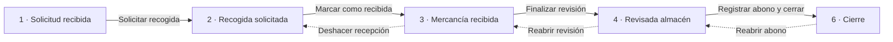

# GPE · Gestión de devoluciones

Aplicación de escritorio (Windows Forms, .NET 10) para seguir una devolución de mercancía desde que el cliente la pide hasta que se le abona y se cierra. Los datos se guardan en SQL Server.

Este documento explica cómo está organizado el código y cómo están hechas las pantallas de cada paso de la devolución, para que cualquiera pueda entenderlas y modificarlas.

---

## 1. Puesta en marcha

1. **Base de datos**: ejecutar [`BaseDatos/crear_tablas.sql`](BaseDatos/crear_tablas.sql) en una base de datos llamada `GPE`.
   - El script ya da de alta la fábrica, los tres roles (*Administración*, *Transporte* y *Almacén*) y los seis estados de la devolución, cada uno con su fase y el rol que hace el paso que lleva a ella:

     | fase | nombre | rol responsable |
     |---|---|---|
     | 1 | Solicitud recibida | Administración |
     | 2 | Recogida solicitada | Transporte |
     | 3 | Mercancía recibida | Almacén |
     | 4 | Revisada almacén | Almacén |
     | 5 | Abono realizado | Administración |
     | 6 | Cierre | Administración |

   - Usuarios, clientes, productos y transportistas (`USUARIO`, `USUARIO_ROL`, `CLIENTE`, `PRODUCTO`, `TRANSPORTISTA`) se dan de alta a mano.
   - Para probar hay dos scripts (con `sqlcmd` hay que ejecutarlos con `-f 65001`, por las tildes):
     - [`permisos_prueba.sql`](BaseDatos/permisos_prueba.sql): crea un usuario por rol (el usuario *Administrador* tiene el rol *Administración*; los otros dos se llaman como su rol). Ver el apartado 4.5.
     - [`prueba_avisos.sql`](BaseDatos/prueba_avisos.sql): crea un único usuario de prueba con los tres roles, para que todos los avisos por correo lleguen a la misma dirección. Ver el apartado 7.
   - La tabla `LOTE` todavía no la usa la aplicación: está preparada para elegir el lote de una lista (hoy el lote es texto libre).

   - Después, ejecutar [`BaseDatos/no_conformidades.sql`](BaseDatos/no_conformidades.sql) para el módulo de calidad (crea sus tablas y rellena los desplegables con la hoja LISTAS del Excel).

2. **Conexión**: por defecto se usa `Server=localhost;Database=GPE;Integrated Security=True`. Para usar otra base de datos (por ejemplo una de pruebas) se define la variable de entorno `GPE_CONEXION` con otra cadena de conexión.
3. **Arrancar**: abrir `GPE.slnx` y ejecutar el proyecto `GPE.Escritorio`. Al entrar se elige el usuario (`FormSeleccionUsuario`, provisional hasta que haya login); ese usuario es el que queda registrado en el historial y sus roles deciden qué puede hacer. Después se abre la ventana principal, con el inicio y el menú lateral de módulos (apartado 4.0).

> Para modificar datos a mano desde SSMS hay que indicar antes el usuario, porque los triggers del historial lo exigen:
> `EXEC sp_set_session_context @key = N'usuario_id', @value = 1;`

---

## 2. Estructura del proyecto

El código está en tres capas. Cada una solo conoce a la de debajo:

```
GPE.Escritorio   →   GPE.Logica   →   GPE.Datos   →   SQL Server
 (pantallas)         (reglas)         (consultas)
                         ↑
                     GPE.Avisos
              (resúmenes diarios por correo)
```

| Proyecto | Qué contiene | Archivos principales |
|---|---|---|
| **GPE.Datos** | Acceso a SQL Server con `Microsoft.Data.SqlClient` (SQL escrito a mano, sin ORM) y los `record` con los datos que viajan entre capas. | `DevolucionRepositorio.cs`, `AvisoRepositorio.cs`, `Conexion.cs`, `Datos.cs` |
| **GPE.Logica** | Reglas de negocio y validaciones. Es lo único que llaman las pantallas. Lanza `ReglaNegocioException` con un mensaje listo para enseñar al usuario. | `DevolucionServicio.cs`, `AvisoServicio.cs`, `HistorialFormateador.cs` |
| **GPE.Escritorio** | Las pantallas (Windows Forms creadas por código, sin diseñador). | Ver apartado 4 |
| **GPE.Avisos** | Programa de consola que envía los resúmenes diarios por correo (apartado 7). | `Program.cs` |

Ejemplo del recorrido de una acción, "Finalizar revisión":

1. `FormAlmacen` recoge las cantidades de la tabla y llama a `servicio.FinalizarRevision(...)`.
2. `DevolucionServicio` comprueba que todas las líneas son correctas; si no, lanza `ReglaNegocioException`.
3. `DevolucionRepositorio` guarda las líneas y cambia la fase en **una transacción**.
4. Los triggers de SQL Server apuntan el cambio en `HISTORIAL_CAMBIOS`.

---

## 3. El proceso: las seis fases

Cada devolución tiene un `estado_id` que apunta a `ESTADO_DEVOLUCION`, y cada estado tiene un número de **fase** del 1 al 6. Ese número es el que manda en toda la aplicación: qué pantalla se abre, qué se puede editar y cómo se pinta la barra de progreso. En el código no se escriben los números sino las constantes de la clase `Fase` ([`Datos.cs`](GPE.Datos/Datos.cs)): `Fase.MercanciaRecibida`, `Fase.Cierre`...



- Las flechas continuas avanzan una fase; las discontinuas son las **reaperturas** (volver atrás), que siempre piden un motivo.
- El abono y el cierre se registran a la vez, así que se pasa directamente de la fase 4 a la 6. La fase 5 solo aparece en la barra como paso completado.
- Solo se puede reabrir el último paso completado: si la revisión ya está cerrada con abono, primero hay que reabrir el abono.

### Fase y paso

Son dos números distintos que conviene no confundir:

- La **fase** es dónde está la devolución (lo que ya se ha hecho).
- El **paso N** es la pantalla con la que se llega a la fase N. Por ejemplo, el paso 3 (*Almacén · llegada*) es el que pasa la devolución a la fase 3 (*Mercancía recibida*).

Por eso, al abrir una devolución se muestra el paso **fase + 1**, el que queda por hacer:

| Fase actual | Paso que se abre | Pantalla | Qué se hace |
|---|---|---|---|
| 1 | 2 | Recogida | Programar la recogida |
| 2 | 3 | Almacén · llegada | Marcar la mercancía como recibida |
| 3 | 4 | Almacén · revisión | Anotar cantidades recibidas y aptas, fotos |
| 4 | 5 | Abono | Registrar el abono y cerrar |
| 6 | 6 | Abono (solo lectura) | Consultar; reabrir el abono si hay un error |

---

## 4. Cómo están hechas las pantallas

### 4.0 Ventana principal y módulos (`FormPrincipal`)

Una sola ventana con un **menú lateral** (*Inicio*, *Devoluciones*...) y la barra superior con el usuario y la fecha. Cada módulo es un `UserControl` que se muestra a la derecha:

| Módulo | Clase | Archivo |
|---|---|---|
| Inicio | `ModuloInicio`: saludo y una tarjeta por módulo con un dato del momento (devoluciones en curso, abonos retrasados...) | `ModuloInicio.cs` |
| Devoluciones | `ModuloDevoluciones`: la lista de devoluciones (apartado 4.1) | `ModuloDevoluciones.cs` |
| No conformidades | `ModuloNoConformidades`: incidencias, no conformidades y acciones de mejora de calidad (apartado 8) | `ModuloNoConformidades.cs` |

- Al arrancar se ve el inicio. Cada módulo se crea la primera vez que se elige y no se cierra al cambiar de módulo, así que conserva sus filtros.
- El de devoluciones se crea desde el principio, porque el **aviso de abonos retrasados** ([`FormAvisoAbonos`](GPE.Escritorio/AvisoAbonos.cs)) tiene que saltar en cualquier módulo; si se elige una devolución en el aviso, la ventana cambia sola a Devoluciones.
- **Añadir un módulo**: una entrada más en `FormPrincipal.CrearModulos` (nombre, frase de su tarjeta, dato del momento y el control que se muestra). El menú y la tarjeta del inicio salen solos.

### 4.1 Lista de devoluciones (`ModuloDevoluciones`)

Lista de devoluciones con filtros (texto, estado, fechas), el estado pintado como una etiqueta del color de su fase, y los botones *Nueva devolución* y *Ver historial*.

Al hacer doble clic en una devolución se abre **el paso en curso** (fase + 1, ver apartado 3). Desde ahí se puede navegar a otros pasos con la barra de progreso:

```csharp
// ModuloDevoluciones.AbrirDevolucion (simplificado)
int paso = Math.Min(devolucion.Fase + 1, FormAbono.PasoCierre);
while (true)
{
    using var pantalla = CrearPantalla(devolucion, paso);
    pantalla.ShowDialog(this);
    if (pantalla.PasoSolicitado == null) break;      // se cerró normalmente
    devolucion = servicio.ObtenerDevolucion(id);      // puede haber cambiado de fase
    paso = Math.Min(pantalla.PasoSolicitado.Value, devolucion.Fase + 1);
}
```

`CrearPantalla` decide qué formulario corresponde a cada paso:

| Paso | Pantalla | Archivo |
|---|---|---|
| 1 | `FormSolicitud` | `Solicitud.cs` |
| 2 | `Recogida` | `Recogida.cs` |
| 3 y 4 | `FormAlmacen` | `Almacen.cs` |
| 5 y 6 | `FormAbono` | `Abono.cs` |

Las demás ventanas no son pasos y se abren desde la lista: `FormNuevaDevolucion` (`NuevaDevolucion.cs`) y `FormHistorial` (`Historial.cs`).

### 4.2 La base común: `PantallaFase`

Todas las pantallas de paso heredan de [`PantallaFase`](GPE.Escritorio/PantallaFase.cs), que aporta:

- **`Progreso(devolucion, pasoVisto)`**: la barra de progreso. Se pueden pulsar los pasos completados y el actual; al pulsar uno, la pantalla se cierra guardando el paso en `PasoSolicitado` y `ModuloDevoluciones` abre el que toca.
- **`PedirMotivo(titulo, explicacion)`**: el diálogo de "¿por qué vuelves atrás?" de las reaperturas (mínimo 5 caracteres).
- **`IrAPaso(paso)`**: para saltar a otro paso desde código (lo usa *Reabrir revisión* en la pantalla de abono).
- **`BotonCerrar()`** y **`BotonReabrir(...)`**: los botones de pie de página que comparten todas las pantallas de paso.
- Si el usuario cancela el cierre (por ejemplo, "tienes cambios sin guardar → No"), se olvida el paso pedido.

### 4.3 Piezas de interfaz reutilizables

Para que todas las pantallas se vean igual, no se colocan controles a mano con coordenadas, sino que se apilan bloques ya hechos:

| Pieza | Para qué |
|---|---|
| [`Tema`](GPE.Escritorio/Tema.cs) | Colores (también los de las celdas: solo lectura, diferencia, error), el color de cada fase, `BotonPrincipal` (morado) y `BotonSecundario` (blanco). |
| [`Componentes.Pagina()`](GPE.Escritorio/Componentes.cs) | Panel con scroll y una columna (`pila`) donde se van añadiendo las secciones de arriba abajo. |
| `Componentes.Cabecera` | Ruta (`DEVOLUCIONES / DEV-2026-001 / ALMACÉN`), título y subtítulo. |
| `Componentes.Resumen` | Fila de datos de referencia: cliente, código de cliente, motivo, fechas... |
| `Componentes.Tarjeta` | Recuadro blanco con título y subtítulo; el contenido se añade después. Opcionalmente, un botón a la derecha del título. |
| `Componentes.Rejilla` | Columnas del mismo ancho para colocar los campos de un formulario. |
| `Componentes.EstiloTabla` / `AjustarAltoTabla` | Aspecto común de las tablas; y que una tabla mida lo que sus filas, sin scroll propio. |
| `Componentes.Fecha` / `Componentes.Es` | Fechas como `20 oct 2026` y la cultura española para fechas e importes. |
| `Componentes.Acciones` | Fila de botones alineados a la derecha. |
| [`CamposFormulario`](GPE.Escritorio/CamposFormulario.cs) | `Campo(etiqueta, control)` con el mensaje de error debajo; `MarcarError` y `LimpiarErrores` al validar. |
| [`BarraProgresoDevolucion`](GPE.Escritorio/BarraProgresoDevolucion.cs) | La barra de los seis pasos, dibujada a mano. |
| [`ControlAdjuntos`](GPE.Escritorio/ControlAdjuntos.cs) | Lista de archivos con *Añadir / Ver / Quitar*. Sirve para el recibo de la agencia (`RECIBO`), las fotos (`FOTO`) y el documento del abono (`ABONO`). Guarda al momento. |
| [`FormVisorImagen`](GPE.Escritorio/VisorImagen.cs) | Visor de fotos dentro de la app (← → para pasar, corrige la orientación de las fotos del móvil). |

Así queda cualquier pantalla de paso:

```csharp
var (scroll, pila) = Componentes.Pagina();
pila.Controls.Add(Componentes.Cabecera(ruta, titulo, subtitulo));
pila.Controls.Add(Progreso(devolucion, paso));
pila.Controls.Add(Componentes.Resumen(("CLIENTE", ...), ("MOTIVO", ...)));
pila.Controls.Add(/* una o varias tarjetas */);
pila.Controls.Add(Componentes.Acciones(btnGuardar, btnCancelar));
Controls.Add(scroll);
```

### 4.4 Patrones que se repiten en todas las pantallas

**Editable o solo lectura según la fase.** Cada pantalla mira `devolucion.Fase` para decidir si se puede tocar. Por ejemplo, la revisión solo es editable en la fase 3; en la 4 se ve igual pero bloqueada. Así se puede volver a consultar cualquier paso pasado desde la barra de progreso.

**`Construir()` y `Recargar()`.** Las pantallas que cambian de modo sin cerrarse (almacén y abono) construyen todo su contenido en un método `Construir()`. Tras marcar como recibida o reabrir un paso, se vuelve a leer la devolución y se llama a `Construir()` otra vez.

**Validación con el error debajo de cada campo.** Al pulsar Guardar se comprueban todos los campos a la vez; cada uno con error muestra su mensaje en rojo justo debajo, y el foco va al primero. El mensaje desaparece en cuanto se corrige el campo. (Lo hace `CamposFormulario`, que usan `FormNuevaDevolucion`, `Recogida` y `FormAbono`.)

**Doble validación.** La pantalla valida para dar mensajes claros campo a campo, y `DevolucionServicio` vuelve a validar las mismas reglas, porque es la capa que realmente protege los datos. La base de datos tiene además sus `CHECK` (por ejemplo, apta ≤ recibida).

**Confirmación antes de lo irreversible.** Cambiar de fase siempre pide un "¿Seguro?" con lo que va a pasar.

**Aviso de cambios sin guardar.** Almacén y abono avisan al cerrar si hay datos escritos sin guardar (los adjuntos no, porque se guardan al momento).

**Otro usuario ya lo cambió.** Todos los cambios de fase son un `UPDATE ... WHERE fase = <la esperada>`. Si devuelve 0 filas, es que otra persona cambió la devolución mientras tanto y se muestra: *"Otro usuario ya ha cambiado el estado de esta devolución. Cierra la pantalla y vuelve a abrirla."*

**Errores de base de datos.** Se capturan `DbException` y se enseña un mensaje en vez de cerrar la aplicación.

### 4.5 Permisos por rol

Cada paso lo hace un rol; quien no lo tiene ve ese paso en **solo consulta** (con el aviso *"Solo consulta: este paso lo hace el rol..."*).

| Rol | Puede |
|---|---|
| **Administración** | *Nueva devolución* (sin el rol no se ve el botón), *Registrar abono y cerrar*, *Reabrir abono*, el documento del abono |
| **Transporte** | Solicitar y modificar la recogida |
| **Almacén** | *Marcar como recibida*, *Deshacer recepción*, la revisión, *Reabrir revisión* (también desde la pantalla del abono), el recibo y las fotos |

La **lista de devoluciones** solo enseña las que esperan algo de los roles del usuario (si tiene varios, las de todos):

| Rol | Ve en la lista |
|---|---|
| **Administración** | Las recién creadas y las revisadas que esperan el abono. Solo a este rol le salen los avisos de abono retrasado. |
| **Transporte** | Las recién creadas. |
| **Almacén** | Las que tienen la recogida programada y las recibidas sin revisar. |

Las cerradas las puede consultar cualquiera: salen al filtrar por el estado *Cierre* o al buscar por número o cliente. Las fases de cada rol están en `DevolucionServicio.FasesPorRol`.

- Los roles del usuario se leen al entrar (`Sesion.Roles`, `Sesion.TieneRol(Rol.Almacen)`). Los nombres están en la clase `Rol` de [`Datos.cs`](GPE.Datos/Datos.cs) y tienen que coincidir con la tabla `ROL`.
- Las pantallas deciden con eso si son editables, y `DevolucionServicio` lo vuelve a comprobar en cada operación (`ExigirRol`), como el resto de validaciones.
- De momento cuentan los roles de cualquier fábrica, porque la aplicación trabaja con una sola.

---

## 5. Cada pantalla en detalle

### Nueva devolución (`FormNuevaDevolucion`)
Datos de la cabecera (código de cliente y cliente, que se rellenan el uno al otro; motivo, fecha de solicitud, observaciones) y las líneas de producto con cantidad y lote. Crea la devolución en la fase 1. El número `DEV-AAAA-NNN` lo calcula la base de datos (columna calculada).

### Paso 1 · Solicitud (`FormSolicitud`)
Solo consulta: los datos con los que se creó la devolución.

### Paso 2 · Recogida (`Recogida`)
Transportista, fecha de recogida prevista, dirección, teléfono y observaciones. Se muestra también la fecha en que se registró el transportista (`RECOGIDA.creada_en`, la pone la base de datos). Se puede modificar hasta que llega la mercancía; después queda en solo lectura. Guardar la recogida pasa la devolución a la fase 2.

### Pasos 3 y 4 · Almacén (`FormAlmacen`)
Una sola clase para dos pasos:
- **Llegada (paso 3)**: el botón *Marcar como recibida* pide el recibo de la agencia y, en una sola transacción, lo guarda, pone la fecha de llegada y pasa a la fase 3. Mientras no se haya revisado, se puede *Deshacer recepción*; el recibo se conserva y no se vuelve a pedir.
- **Revisión (paso 4)**: como la hoja que rellena el almacén.
  - Arriba, **agencia** (propone el transportista de la recogida) y **mercancía revisada por** (propone el usuario de GPE); los dos se pueden cambiar.
  - Después, una tabla (`REVISION_LINEA`) con **código** (desplegable; la descripción y el formato salen del producto), **lote**, **caducidad**, **cantidad** y **apto para servir** (Sí/No). La primera vez trae los productos indicados al crear la devolución, si los hay; se pueden añadir y quitar líneas. Si de un producto unas unidades están bien y otras no, van en dos líneas.
  - Por último, observaciones y fotos.
  - *Finalizar revisión* guarda todo (las líneas se sustituyen enteras) y pasa a la fase 4; luego queda *Reabrir revisión*.

### Pasos 5 y 6 · Abono y cierre (`FormAbono`)
- **Resultado de la revisión** (solo lectura): agencia y quién revisó, las líneas del almacén con el total de unidades aptas y no aptas, observaciones y fotos. Es lo que necesita quien decide el abono.
- **Abono**: resultado (*total*, *parcial* o *sin abono*), nº de abono, fecha, importe y observaciones, más el documento del abono (PDF o imagen).
  - Si hay abono: número, importe > 0 y documento son obligatorios.
  - Parcial o sin abono: hay que explicar el motivo en observaciones.
  - La fecha va de la llegada de la mercancía a hoy.
  - Si todo llegó y está apto, se propone *Abono total*.
  - Si el nº de abono ya está en otra devolución, la confirmación lo avisa (no lo impide: un mismo abono puede cubrir varias).
- *Registrar abono y cerrar* pasa de la fase 4 a la 6. Una vez cerrada, la pantalla es de consulta y ofrece *Reabrir abono* (vuelve a la fase 4 conservando los datos para corregirlos).

### Historial (`FormHistorial`)
Lista cronológica de todo lo que se ha hecho en una devolución, quién y cuándo, con una franja del color de la fase cuando hubo cambio de fase. Ver el apartado 6.

---

## 6. El historial de cambios

El historial **no lo escribe la aplicación**, lo escriben triggers de SQL Server, así que no se puede olvidar ningún cambio.

1. Al abrir cada conexión, la aplicación le dice a SQL Server quién es el usuario (`sp_set_session_context`). Si no lo hace, los triggers dan error.
2. Cada tabla importante (`DEVOLUCION`, `DEVOLUCION_PRODUCTO`, `RECOGIDA`, `ADJUNTO`) tiene un trigger que, en cada INSERT / UPDATE / DELETE, guarda en `HISTORIAL_CAMBIOS` la fila de antes y la de después **en formato JSON** (`FOR JSON PATH`).
3. [`HistorialFormateador`](GPE.Logica/HistorialFormateador.cs) lee esas filas y las convierte en frases:
   - Agrupa los cambios hechos en la misma transacción (un mismo "Guardar") en una sola entrada.
   - Compara el JSON de antes y después y solo enseña lo que cambió (`Importe del abono: 120,00 € → 150,00 €`).
   - Cambia ids por nombres (`cliente_id: 3` → el nombre del cliente) y da formato a fechas e importes.
   - Pone un título según lo que pasó: *Solicitó la recogida*, *Finalizó la revisión*, *Reabrió el abono*...

**¿Por qué JSON?** Porque así una sola tabla de historial sirve para todas las tablas aunque tengan columnas distintas, y al añadir una columna nueva (como las del abono) el historial la recoge solo, sin tocar los triggers. El trigger de `ADJUNTO` es la excepción: lista las columnas a mano para no copiar el contenido del archivo al historial.

---

## 7. Avisos por correo

Cuando una devolución pasa de paso se avisa por correo a quien le toca el siguiente, sin que nadie tenga que escribirlo:

| Momento | Aviso a | Cuándo | Tipo |
|---|---|---|---|
| Se crea la devolución | Transporte (programar la recogida) | Al momento | `NUEVA_DEVOLUCION` |
| Se solicita la recogida (solo la primera vez, no al modificarla) | Almacén (va a llegar mercancía) | Al momento | `RECOGIDA_SOLICITADA` |
| Mercancía recibida y sin revisar | Almacén | Cada día hasta que se revise | Resumen `REVISION_PENDIENTE` |
| Se finaliza la revisión | Administración (registrar el abono) | Al momento | `REVISION_FINALIZADA` |
| Revisada y sin abono | Administración | Cada día hasta que se registre | Resumen `ABONO_PENDIENTE` |
| Se registra el abono | Almacén (cómo ha quedado el abono) | Al momento | `ABONO_REGISTRADO` |

### Cómo funciona

1. **A quién:** a los usuarios con el rol responsable del paso siguiente (`ESTADO_DEVOLUCION.rol_responsable_id`) en la fábrica de la devolución (`USUARIO_ROL`).
2. **Cola en la base de datos:** el aviso se apunta en `AVISO_CORREO` dentro de la misma transacción que el cambio que lo provoca. Si el correo falla, la devolución se guarda igual.
3. **Envío:** [`AvisoServicio`](GPE.Logica/AvisoServicio.cs) los envía en segundo plano con MailKit, justo después de guardar y al abrir la aplicación. Si falla, guarda el motivo en `ultimo_error` y lo reintenta (hasta 5 veces).

### Cuenta de envío

Se configura en cada ordenador con variables de entorno, para que la contraseña no esté en el código:

| Variable | Valor |
|---|---|
| `GPE_SMTP_USUARIO` | Cuenta que envía (p. ej. `avisos@empresa.com`) |
| `GPE_SMTP_CLAVE` | Contraseña de aplicación de esa cuenta (en Gmail: myaccount.google.com/apppasswords, requiere verificación en dos pasos) |
| `GPE_SMTP_SERVIDOR` | Opcional, por defecto `smtp.gmail.com` |
| `GPE_SMTP_PUERTO` | Opcional, por defecto `465` |

Se guardan con `setx NOMBRE "valor"` y hay que volver a abrir la aplicación. Sin configurar, los avisos se quedan pendientes.

Para probarlo, [`prueba_avisos.sql`](BaseDatos/prueba_avisos.sql) crea un usuario con los tres roles y un correo de prueba, así que todos los avisos llegan a esa dirección.

### Resúmenes diarios (sin abrir GPE)

El programa de consola [`GPE.Avisos`](GPE.Avisos/Program.cs) envía cada mañana un único correo por persona con lo que tiene pendiente, de lo más antiguo a lo más nuevo:

- Al *Almacén*: las devoluciones con la mercancía recibida y sin revisar.
- A *Administración*: las revisadas que esperan el abono.

Además:

- Envía también los avisos de `AVISO_CORREO` que se quedaron pendientes.
- `AVISO_RESUMEN` evita mandar el mismo resumen dos veces el mismo día.
- Lo ejecuta una tarea programada de Windows en un ordenador que esté encendido por la mañana, con las mismas variables `GPE_SMTP_*` (y `GPE_CONEXION` si la base de datos no está en `localhost`).
- Deja lo que hace en `%LOCALAPPDATA%\GPE\avisos.log`.

---

## 8. Cómo añadir algo nuevo

**Un campo nuevo en un paso existente**
1. Columna en `crear_tablas.sql` (y un script `ALTER TABLE` para las bases de datos ya creadas).
2. Leerlo y guardarlo en `DevolucionRepositorio`, con su `record` en `Datos.cs`.
3. Validarlo en `DevolucionServicio`.
4. Añadir el control en la tarjeta de la pantalla con `campos.Campo(...)` (`CamposFormulario`).
5. Darle un nombre legible en `NombresCampos` de `HistorialFormateador` (el historial ya lo registra solo).

**Una pantalla nueva de paso**
1. Clase que herede de `PantallaFase`, con una constante `PasoXxx` igual a su `Fase`.
2. Construirla con `Componentes.Pagina()` y el resto de piezas del apartado 4.3.
3. Decidir con `devolucion.Fase` (comparando con las constantes de `Fase`) si es editable o de consulta.
4. Cambio de fase en el repositorio con `UPDATE ... WHERE fase = <esperada>` y devolver `false` si no se actualizó nada.
5. Añadirla en `ModuloDevoluciones.CrearPantalla` y su título en `TitulosPorFase` del historial.

---

## 8. Incidencias y no conformidades (calidad)

Sustituye al Excel *INCIDENCIAS Y NO CONFORMIDADES - CALIDAD* (MT-RG09). Cada fila de la hoja INCIDENCIAS es un registro de la tabla `NO_CONFORMIDAD`, con las mismas columnas.

| Pieza | Archivo |
|---|---|
| Tablas, historial y opciones de los desplegables | [`BaseDatos/no_conformidades.sql`](BaseDatos/no_conformidades.sql) |
| `record NoConformidad`, `TipoRegistro`, `ListaCalidad` | [`GPE.Datos/DatosCalidad.cs`](GPE.Datos/DatosCalidad.cs) |
| Consultas | [`GPE.Datos/NoConformidadRepositorio.cs`](GPE.Datos/NoConformidadRepositorio.cs) |
| Estado, validaciones y guardado | [`GPE.Logica/NoConformidadServicio.cs`](GPE.Logica/NoConformidadServicio.cs) |
| Lista con filtros | [`GPE.Escritorio/ModuloNoConformidades.cs`](GPE.Escritorio/ModuloNoConformidades.cs) |
| Ficha (nuevo y editar) | [`GPE.Escritorio/FormNoConformidad.cs`](GPE.Escritorio/FormNoConformidad.cs) |
| Pestañas de fases de la ficha | [`GPE.Escritorio/BarraFasesCalidad.cs`](GPE.Escritorio/BarraFasesCalidad.cs) |

- **Tipo de registro**: no conformidad (`NC`), incidencia o acción de mejora. Como en el Excel, *Tipo* es solo para las NC y *MC/PCC/BPM*, *Parámetro* y *Operario* solo para las incidencias: la ficha oculta lo que no toca y al guardar se vacía.
- **Desplegables**: salen de `CALIDAD_LISTA` (la hoja LISTAS). El registro guarda el texto elegido, así que cambiar o desactivar una opción (`activo = 0`) no altera lo ya registrado; si un registro tiene un valor que ya no está en la lista, la ficha lo sigue mostrando.
- **Nº**: automático, como en el Excel. Cada tipo tiene su serie: NC 558, 559... (no empieza cada año); NC de auditoría externa `AC-2026-1`... (empieza cada año); NC de auditoría interna `AI-20/04/26-1`... (empieza en cada auditoría); incidencias 1, 2, 3...; las acciones de mejora no llevan. Se calcula al guardar (`NoConformidadServicio.Serie`), así dos personas no se llevan el mismo. Un registro conserva su número mientras no cambie de serie. Es texto y sin `UNIQUE` porque en el Excel hay otros formatos (`LC25-06`) y algún número repetido.
- **Estado**: no se guarda, se calcula como la fórmula del Excel: con fecha fin, *Cerrada*; si no, *En plazo* hasta la fecha prevista y *Fuera de plazo* después. Una abierta sin fecha prevista sale como *Sin plazo* (en el Excel salía *Fuera de plazo*).
- **Fases**: la ficha tiene una tarjeta por fase y solo enseña la de la fase elegida. Arriba, fijas, las fases son botones a modo de pestañas: la elegida en morado, las hechas con ✓ y las opcionales en gris; al pulsar una se pasa a ella. Un registro nuevo se abre en *Registro*; uno guardado, en la fase en curso. Si al guardar hay un error en otra fase, la ficha cambia a esa fase. Las fases no se guardan: `NoConformidadServicio.Fases` las calcula con lo rellenado, y se pueden completar en cualquier orden. Son *Registro* (hay problema), *Acción inmediata* (hay alguna), *Análisis* (descripción de la causa o causa raíz), *Corrección* (hay correctoras y todas están hechas; en las mejoras se llama *Acciones de mejora*) y *Verificación y cierre* (fecha fin; ahí también los seguimientos). Todos los tipos las tienen todas, pero algunas son opcionales: en las incidencias, análisis y corrección; en las mejoras, acción inmediata y análisis. La fase en curso es la primera necesaria sin hacer; un registro cerrado no tiene ninguna.
- **Validaciones**: fecha, sección y problema siempre; en las NC también origen y tipo. Origen R (reclamación) pide el cliente y origen P, el proveedor. Las fechas prevista y fin no pueden ser anteriores a la detección.
- **Acciones inmediatas y correctoras**: en la ficha son dos tablas ([`TablaAcciones`](GPE.Escritorio/TablaAcciones.cs)) con una fila por acción: hecha, acción, fecha (manual), responsable y observaciones. Se guardan en `NC_ACCION` (`clase` = `INMEDIATA` o `CORRECTORA`) junto con el registro, en la misma transacción. Las filas vacías no se guardan. En bases de datos creadas antes, [`BaseDatos/nc_acciones.sql`](BaseDatos/nc_acciones.sql) crea la tabla, pasa los textos antiguos a la primera fila de cada tabla y quita las columnas viejas.
- **Seguimientos**: en *Verificación y cierre* hay otra `TablaAcciones`, una fila por comprobación (comprobación, fecha, responsable, observaciones; sin "hecha"). La fecha es obligatoria y una fila nueva ya trae la de hoy. Se guardan también en `NC_ACCION`, con `clase` = `SEGUIMIENTO`. En bases de datos creadas antes, [`BaseDatos/nc_seguimientos.sql`](BaseDatos/nc_seguimientos.sql) admite esa clase, pasa el texto antiguo de `NO_CONFORMIDAD.seguimiento` a una fila (con la fecha si el texto empieza por una) y quita la columna. Los que vienen del texto antiguo pueden quedarse sin fecha.
- **Historial**: un trigger apunta cada cambio en `HISTORIAL_CAMBIOS` (`tabla_afectada = 'NO_CONFORMIDAD'` o `'NC_ACCION'`), como en devoluciones. Todavía no hay pantalla para verlo.
