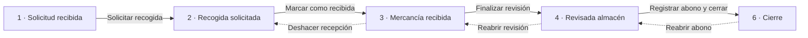

# GPE

Aplicación de escritorio (Windows Forms, .NET 10) con dos módulos:

- **Devoluciones**: sigue una devolución de mercancía desde que el cliente la pide hasta que se le abona y se cierra.
- **No conformidades**: incidencias, no conformidades y acciones de mejora de calidad (sustituye al Excel MT-RG09).

Los datos se guardan en SQL Server. Este documento explica cómo está organizado el código, para que cualquiera pueda entenderlo y modificarlo.

---

## 1. Puesta en marcha

1. **Base de datos**: en una base de datos llamada `GPE`, ejecutar:
   - [`crear_tablas.sql`](BaseDatos/crear_tablas.sql): tablas de devoluciones. Ya da de alta la fábrica, los cuatro roles (los tres de devoluciones y Calidad) y los seis estados (apartado 3).
   - [`no_conformidades.sql`](BaseDatos/no_conformidades.sql): tablas de calidad y opciones de los desplegables (la hoja LISTAS del Excel).
   - [`rutina_calidad.sql`](BaseDatos/rutina_calidad.sql): tablas de la rutina del supervisor de calidad, con las máquinas y los puntos de control de la hoja de chequeos diarios.
   - [`control_agua.sql`](BaseDatos/control_agua.sql): tablas del control de agua (hoja AGUA del Excel de calidad), con los puntos de agua que se revisan.
   - [`rutina_revisiones.sql`](BaseDatos/rutina_revisiones.sql): solo en bases de datos creadas antes de que la rutina tuviera varias revisiones por día. Se puede ejecutar más de una vez.
   - [`importar_no_conformidades.ps1`](BaseDatos/importar_no_conformidades.ps1), una sola vez: pasa los registros del Excel a la base de datos.

   Usuarios, clientes, productos y transportistas se dan de alta a mano. Para probar, [`permisos_prueba.sql`](BaseDatos/permisos_prueba.sql) crea un usuario por rol y [`prueba_avisos.sql`](BaseDatos/prueba_avisos.sql) uno con los tres roles, para recibir todos los avisos por correo. Con `sqlcmd` hay que ejecutarlos con `-f 65001`, por las tildes.

2. **Conexión**: por defecto `Server=localhost;Database=GPE;Integrated Security=True`. Para usar otra base de datos se define la variable de entorno `GPE_CONEXION`.
3. **Arrancar**: abrir `GPE.slnx` y ejecutar `GPE.Escritorio`. Al entrar se elige el usuario (provisional hasta que haya login); queda registrado en el historial y sus roles deciden qué puede hacer.

> Para modificar datos a mano desde SSMS hay que indicar antes el usuario, porque los triggers del historial lo exigen:
> `EXEC sp_set_session_context @key = N'usuario_id', @value = 1;`

---

## 2. Estructura del proyecto

El código está en tres capas. Cada una solo conoce a la de debajo:

```
GPE.Escritorio   →   GPE.Logica   →   GPE.Datos   →   SQL Server
 (pantallas)         (reglas)         (consultas)
                         ↑
                     GPE.Avisos
              (resúmenes diarios por correo)
```

| Proyecto | Qué contiene |
|---|---|
| **GPE.Datos** | Acceso a SQL Server con `Microsoft.Data.SqlClient` (SQL escrito a mano, sin ORM) y los `record` que viajan entre capas. |
| **GPE.Logica** | Reglas de negocio y validaciones. Es lo único que llaman las pantallas. Lanza `ReglaNegocioException` con un mensaje listo para enseñar al usuario. |
| **GPE.Escritorio** | Las pantallas (Windows Forms creadas por código, sin diseñador). |
| **GPE.Avisos** | Programa de consola que envía los resúmenes diarios por correo (apartado 7). |

Ejemplo, "Finalizar revisión": `FormAlmacen` llama a `DevolucionServicio.FinalizarRevision`, que valida las líneas; `DevolucionRepositorio` las guarda y cambia la fase en una transacción, y los triggers apuntan el cambio en el historial.

---

## 3. Devoluciones: las seis fases

Cada devolución tiene un estado (`ESTADO_DEVOLUCION`) con un número de **fase** del 1 al 6. Ese número decide qué pantalla se abre, qué se puede editar y cómo se pinta la barra de progreso. En el código se usan las constantes de la clase `Fase` ([`Datos.cs`](GPE.Datos/Datos.cs)), no los números.



- Las flechas discontinuas son las **reaperturas**: siempre piden un motivo y solo se puede reabrir el último paso completado.
- El abono y el cierre se registran a la vez, así que se pasa de la fase 4 a la 6.

**Fase y paso.** La fase es dónde está la devolución; el **paso N** es la pantalla con la que se llega a la fase N. Al abrir una devolución se muestra el paso fase + 1, el que queda por hacer:

| Paso | Pantalla | Archivo | Rol |
|---|---|---|---|
| 1 | Solicitud (consulta) | `Solicitud.cs` | Administración |
| 2 | Recogida | `Recogida.cs` | Transporte |
| 3 y 4 | Almacén: llegada y revisión | `Almacen.cs` | Almacén |
| 5 y 6 | Abono y cierre | `Abono.cs` | Administración |

---

## 4. Cómo están hechas las pantallas

**Ventana principal.** `FormPrincipal` tiene un menú lateral con los módulos (`ModuloInicio`, `ModuloDevoluciones`, `ModuloNoConformidades`), que son `UserControl`. Para añadir uno basta una entrada en `FormPrincipal.CrearModulos`: el menú y la tarjeta del inicio salen solos.

**Pantallas de paso.** Heredan de [`PantallaFase`](GPE.Escritorio/PantallaFase.cs), que aporta la barra de progreso (se puede saltar a otro paso pulsándolo), el diálogo de motivo de las reaperturas y los botones comunes.

**Piezas reutilizables.** No se colocan controles con coordenadas: se apilan bloques ya hechos de [`Componentes`](GPE.Escritorio/Componentes.cs) (`Pagina`, `Cabecera`, `Resumen`, `Tarjeta`, `Rejilla`, `Acciones`...), con los colores de [`Tema`](GPE.Escritorio/Tema.cs). Los formularios usan [`CamposFormulario`](GPE.Escritorio/CamposFormulario.cs) para mostrar el error debajo de cada campo, y los adjuntos van con [`ControlAdjuntos`](GPE.Escritorio/ControlAdjuntos.cs), que guarda al momento.

**Reglas comunes:**
- Cada pantalla mira la fase para decidir si es editable o de solo consulta, así se puede volver a ver cualquier paso pasado.
- La pantalla valida para dar mensajes claros y el servicio vuelve a validar, porque es el que protege los datos.
- Cambiar de fase pide confirmación, y cerrar con cambios sin guardar avisa.
- Los cambios de fase son `UPDATE ... WHERE fase = <la esperada>`: si no actualiza nada, otro usuario la cambió antes y se avisa.

### Permisos por rol

El menú enseña los módulos de los roles del usuario (`Sesion.VeDevoluciones` y `Sesion.VeCalidad`): las devoluciones, a Administración, Transporte y Almacén (y en consulta a quien no tiene ningún rol); las no conformidades, la rutina y el control de agua, al rol Calidad. Quien tenga varios roles ve los módulos de todos.

Cada paso lo hace un rol (tabla del apartado 3); quien no lo tiene lo ve en solo consulta. La lista de devoluciones solo enseña las que esperan algo de los roles del usuario (`DevolucionServicio.FasesPorRol`); las cerradas las puede consultar cualquiera filtrando o buscando.

Los nombres de los roles están en la clase `Rol` de [`Datos.cs`](GPE.Datos/Datos.cs) y tienen que coincidir con la tabla `ROL`. `DevolucionServicio` vuelve a comprobar el rol en cada operación (`ExigirRol`).

---

## 5. Historial de cambios

El historial **no lo escribe la aplicación**, lo escriben triggers de SQL Server, así que no se puede olvidar ningún cambio.

1. Al abrir cada conexión, la aplicación le dice a SQL Server quién es el usuario (`sp_set_session_context`).
2. Los triggers guardan en `HISTORIAL_CAMBIOS` la fila de antes y la de después **en JSON**. Así una sola tabla sirve para todas y una columna nueva se registra sola, sin tocar los triggers.
3. [`HistorialFormateador`](GPE.Logica/HistorialFormateador.cs) agrupa los cambios de cada transacción, enseña solo lo que cambió y lo convierte en frases (*Finalizó la revisión*, `Importe del abono: 120,00 € → 150,00 €`).

---

## 6. No conformidades (calidad)

Cada fila de la hoja INCIDENCIAS del Excel es un registro de `NO_CONFORMIDAD`, con las mismas columnas. Hay tres tipos: no conformidad (NC), incidencia y acción de mejora.

| Pieza | Archivo |
|---|---|
| Datos | [`DatosCalidad.cs`](GPE.Datos/DatosCalidad.cs), [`NoConformidadRepositorio.cs`](GPE.Datos/NoConformidadRepositorio.cs) |
| Reglas | [`NoConformidadServicio.cs`](GPE.Logica/NoConformidadServicio.cs) |
| Lista | [`ModuloNoConformidades.cs`](GPE.Escritorio/ModuloNoConformidades.cs) |
| Ficha | [`FormNoConformidad.cs`](GPE.Escritorio/FormNoConformidad.cs), [`BarraFasesCalidad.cs`](GPE.Escritorio/BarraFasesCalidad.cs), [`TablaAcciones.cs`](GPE.Escritorio/TablaAcciones.cs) |

Lo que no es evidente al leer el código:

- **Desplegables**: salen de `CALIDAD_LISTA`. El registro guarda el texto elegido, así que cambiar o desactivar una opción no altera lo ya registrado.
- **Nº**: se calcula al guardar, con una serie por tipo como en el Excel (`NoConformidadServicio.Serie`). Es texto sin `UNIQUE` porque en el Excel hay otros formatos y algún número repetido.
- **Estado y fases no se guardan**: se calculan con lo rellenado (`NoConformidadServicio.Fases`). El estado sigue la fórmula del Excel (*Cerrada*, *En plazo*, *Fuera de plazo*).
- **Acciones inmediatas, correctoras y seguimientos**: van en `NC_ACCION`, una fila por acción, distinguidas por `clase`.
- **Historial**: lo apuntan triggers igual que en devoluciones. Todavía no hay pantalla para verlo.
- **Dos personas en la misma ficha**: al abrir una ficha, GPE lo apunta en `NC_BLOQUEO` y renueva el apunte cada minuto. Si otra persona la abre mientras tanto, le sale *"María tiene abierta esta ficha desde las 10:42 en el equipo PC-CALIDAD"* y la ve en solo lectura. Un bloqueo que lleva 3 minutos sin renovarse (GPE se cerró de golpe, se fue la luz...) deja de contar. Por si aun así dos guardan a la vez, `NO_CONFORMIDAD.version` (`ROWVERSION`) hace que el segundo no pueda sobrescribir los cambios del primero.

### Rutina del supervisor de calidad

Sustituye a la hoja de Google Sheets "CHEQUEOS DIARIOS - PCC" que calidad rellena cada día al recorrer la fábrica. Es una tabla con los puntos de control en filas y las máquinas o secciones en columnas, y hay una ronda por día.

| Pieza | Archivo |
|---|---|
| Datos | [`DatosRutina.cs`](GPE.Datos/DatosRutina.cs), [`RutinaRepositorio.cs`](GPE.Datos/RutinaRepositorio.cs) |
| Reglas | [`RutinaServicio.cs`](GPE.Logica/RutinaServicio.cs) |
| Pantallas | [`ModuloRutinaCalidad.cs`](GPE.Escritorio/ModuloRutinaCalidad.cs), [`FormPlantillaRutina.cs`](GPE.Escritorio/FormPlantillaRutina.cs) |

- **Plantilla**: las máquinas (`RUTINA_SECCION`), los puntos de control (`RUTINA_PUNTO`) y qué se revisa en cada máquina (`RUTINA_APLICA`). Lo último se cambia desde el botón "Plantilla"; las máquinas y los puntos, de momento, en la base de datos.
- **Pantalla**: tres pestañas, como la hoja: planta baja, planta superior (`RUTINA_SECCION.planta`) y observaciones. Al pulsar una casilla salen las opciones de la leyenda; las grises son las que no se revisan en esa máquina. El botón ☰ de la barra superior oculta el menú lateral para ganar sitio.
- **Revisiones**: el segundo cuadrado de cada máquina en la hoja. La 1ª revisión es la ronda completa; con "+ Nueva revisión" se empieza otra con la plantilla entera en blanco, y cada una tiene su pestaña con la hora en que se empezó (`RUTINA_REVISION`; las casillas llevan su `revision`). Una revisión en la que no se marca nada no se guarda, y mientras la última esté vacía no se puede empezar otra.
- **Observaciones**: son del día, no de cada revisión. El pie de la hoja: la caja de herramientas (operario y estado) y los depósitos van en `RUTINA`; las observaciones de cada sección, en `RUTINA_OBSERVACION`.
- **Casillas**: en `RUTINA_RESULTADO` solo se guardan las rellenas. Cada una tiene un estado (correcto, no correcto, no aplica o mantenimiento) o, en los puntos numéricos como PESOS, un valor, y puede llevar un comentario. Al guardar solo se escriben las casillas que han cambiado, para no llenar el historial.
- **Incidencias**: desde una casilla "no correcta" se abre la ficha de una incidencia nueva ya rellenada (fecha, sección, MC/PCC/BPM y problema), y al guardarla queda apuntada en la casilla (`no_conformidad_id`). La sección y el MC/PCC/BPM que se proponen salen de `RUTINA_SECCION.seccion_calidad` y `RUTINA_PUNTO.mc_pcc_bpm`.
- **Dos personas en la misma ronda**: `RUTINA.version` hace que el segundo en guardar no pise al primero; tiene que recargar.
- **Historial**: lo apuntan triggers, como en las incidencias.

### Control de agua

Sustituye a la hoja AGUA (MT-RG09) del Excel de calidad: cada día se apuntan los puntos de agua que se han revisado, con el cloro y los organolépticos.

| Pieza | Archivo |
|---|---|
| Datos | [`DatosAgua.cs`](GPE.Datos/DatosAgua.cs), [`AguaRepositorio.cs`](GPE.Datos/AguaRepositorio.cs) |
| Reglas | [`AguaServicio.cs`](GPE.Logica/AguaServicio.cs) |
| Pantalla | [`ModuloControlAgua.cs`](GPE.Escritorio/ModuloControlAgua.cs) |

- **Pantalla**: como la rutina, se elige el día arriba (calendario, flechas y "Hoy") y debajo hay una tabla con una fila por punto revisado: punto de agua, cloro, sabor, olor, color, turbidez y comentario. Con "+ Añadir fila" se apunta otro; con Supr se quita. "Guardar" guarda el día entero.
- **Puntos de agua** (`AGUA_TOMA`): los que se pueden elegir en la tabla. De momento se cambian en la base de datos.
- **Rango de cloro**: `AGUA_TOMA.cloro_min` y `cloro_max`, vacíos hasta que calidad los dé. Con rango, el cloro que se sale se ve en rojo.
- **Controles** (`AGUA_CONTROL`): uno por punto y día. El cloro se deja vacío si no se ha medido. Al guardar solo se escriben las filas nuevas, las cambiadas y las quitadas.
- **Dos personas en el mismo día**: `AGUA_CONTROL.version` hace que el segundo en guardar no pise al primero; tiene que recargar.
- **Historial**: lo apunta un trigger, como en las incidencias.

---

## 7. Avisos por correo

Cuando una devolución avanza se avisa a quien le toca el siguiente paso (el rol de `ESTADO_DEVOLUCION.rol_responsable_id` en la fábrica de la devolución). El aviso se apunta en `AVISO_CORREO` en la misma transacción que el cambio, y [`AvisoServicio`](GPE.Logica/AvisoServicio.cs) lo envía en segundo plano; si el correo falla, la devolución se guarda igual y se reintenta.

Además, [`GPE.Avisos`](GPE.Avisos/Program.cs) envía cada mañana un resumen por persona con lo que tiene pendiente (revisiones al Almacén, abonos a Administración) y los avisos que quedaron sin enviar. Lo ejecuta una tarea programada de Windows y deja un registro en `%LOCALAPPDATA%\GPE\avisos.log`.

**Cuenta de envío.** Se configura en cada ordenador con variables de entorno (`setx NOMBRE "valor"` y volver a abrir la aplicación). Sin ellas, los avisos se quedan pendientes.

| Variable | Valor |
|---|---|
| `GPE_SMTP_USUARIO` | Cuenta que envía |
| `GPE_SMTP_CLAVE` | Contraseña de aplicación de esa cuenta (en Gmail requiere verificación en dos pasos) |
| `GPE_SMTP_SERVIDOR` | Opcional, por defecto `smtp.gmail.com` |
| `GPE_SMTP_PUERTO` | Opcional, por defecto `465` |

---

## 8. Cómo añadir algo nuevo

**Un campo nuevo en un paso existente**
1. Columna en el script de tablas (y un `ALTER TABLE` para las bases de datos ya creadas).
2. Leerlo y guardarlo en el repositorio, con su `record`.
3. Validarlo en el servicio.
4. Añadir el control en la pantalla con `campos.Campo(...)`.
5. Darle un nombre legible en `NombresCampos` de `HistorialFormateador`.

**Una pantalla nueva de paso de devolución**
1. Clase que herede de `PantallaFase`, con una constante `PasoXxx` igual a su `Fase`.
2. Construirla con las piezas de `Componentes`.
3. Cambio de fase en el repositorio con `UPDATE ... WHERE fase = <esperada>`.
4. Añadirla en `ModuloDevoluciones.CrearPantalla` y su título en `TitulosPorFase` del historial.
