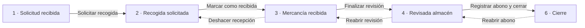

# GPE · Gestión de devoluciones

Aplicación de escritorio (Windows Forms, .NET 10) para seguir una devolución de mercancía desde que el cliente la pide hasta que se le abona y se cierra. Los datos se guardan en SQL Server.

Este documento explica cómo está organizado el código y cómo están hechas las pantallas de cada paso de la devolución, para que cualquiera pueda entenderlas y modificarlas.

---

## 1. Puesta en marcha

1. **Base de datos**: ejecutar [`BaseDatos/crear_tablas.sql`](BaseDatos/crear_tablas.sql) en una base de datos llamada `GPE`.
   - Las tablas de catálogo (`ESTADO_DEVOLUCION`, `FABRICA`, `CLIENTE`, `PRODUCTO`, `USUARIO`, `TRANSPORTISTA`...) se rellenan a mano. Los estados tienen que ser estos seis, con su fase:

     | fase | nombre |
     |---|---|
     | 1 | Solicitud recibida |
     | 2 | Recogida solicitada |
     | 3 | Mercancía recibida |
     | 4 | Revisada almacén |
     | 5 | Abono realizado |
     | 6 | Cierre |

   - Las tablas `ROL`, `USUARIO_ROL` y `LOTE` todavía no las usa la aplicación: están preparadas para cuando haya login con permisos por rol y fábrica, y para elegir el lote de una lista (hoy el lote es texto libre).

2. **Conexión**: por defecto se usa `Server=localhost;Database=GPE;Integrated Security=True`. Para usar otra base de datos (por ejemplo una de pruebas) se define la variable de entorno `GPE_CONEXION` con otra cadena de conexión.
3. **Arrancar**: abrir `GPE.slnx` y ejecutar el proyecto `GPE.Escritorio`. Al entrar se elige el usuario (pantalla provisional hasta que haya login); ese usuario es el que queda registrado en el historial.

> Para modificar datos a mano desde SSMS hay que indicar antes el usuario, porque los triggers del historial lo exigen:
> `EXEC sp_set_session_context @key = N'usuario_id', @value = 1;`

---

## 2. Estructura del proyecto

El código está en tres capas. Cada una solo conoce a la de debajo:

```
GPE.Escritorio   →   GPE.Logica   →   GPE.Datos   →   SQL Server
 (pantallas)         (reglas)         (consultas)
```

| Proyecto | Qué contiene | Archivos principales |
|---|---|---|
| **GPE.Datos** | Acceso a SQL Server con `Microsoft.Data.SqlClient` (SQL escrito a mano, sin ORM) y los `record` con los datos que viajan entre capas. | `DevolucionRepositorio.cs`, `Datos.cs` |
| **GPE.Logica** | Reglas de negocio y validaciones. Es lo único que llaman las pantallas. Lanza `ReglaNegocioException` con un mensaje listo para enseñar al usuario. | `DevolucionServicio.cs`, `HistorialFormateador.cs` |
| **GPE.Escritorio** | Las pantallas (Windows Forms creadas por código, sin diseñador). | Ver apartado 4 |

Ejemplo del recorrido de una acción, "Finalizar revisión":

1. `FormAlmacen` recoge las cantidades de la tabla y llama a `servicio.FinalizarRevision(...)`.
2. `DevolucionServicio` comprueba que todas las líneas son correctas; si no, lanza `ReglaNegocioException`.
3. `DevolucionRepositorio` guarda las líneas y cambia la fase en **una transacción**.
4. Los triggers de SQL Server apuntan el cambio en `HISTORIAL_CAMBIOS`.

---

## 3. El proceso: las seis fases

Cada devolución tiene un `estado_id` que apunta a `ESTADO_DEVOLUCION`, y cada estado tiene un número de **fase** del 1 al 6. Ese número es el que manda en toda la aplicación: qué pantalla se abre, qué se puede editar y cómo se pinta la barra de progreso. En el código no se escriben los números sino las constantes de la clase `Fase` ([`Datos.cs`](GPE.Datos/Datos.cs)): `Fase.MercanciaRecibida`, `Fase.Cierre`...



- Las flechas continuas avanzan una fase; las discontinuas son las **reaperturas** (volver atrás), que siempre piden un motivo.
- El abono y el cierre se registran a la vez, así que se pasa directamente de la fase 4 a la 6. La fase 5 solo aparece en la barra como paso completado.
- Solo se puede reabrir el último paso completado: si la revisión ya está cerrada con abono, primero hay que reabrir el abono.

| Fase actual | Pantalla que se abre | Qué se hace |
|---|---|---|
| 1 | Recogida | Programar la recogida |
| 2 | Almacén · llegada | Marcar la mercancía como recibida |
| 3 | Almacén · revisión | Anotar cantidades recibidas y aptas, fotos |
| 4 | Abono | Registrar el abono y cerrar |
| 6 | Abono (solo lectura) | Consultar; reabrir el abono si hay un error |

---

## 4. Cómo están hechas las pantallas

### 4.1 Pantalla principal (`FormPrincipal`)

Lista de devoluciones con filtros (texto, estado, fechas), el estado pintado como una etiqueta del color de su fase, y los botones *Nueva devolución* y *Ver historial*.

Al hacer doble clic en una devolución se abre **el paso en curso** (el siguiente al último completado). Desde ahí se puede navegar a otros pasos con la barra de progreso:

```csharp
// FormPrincipal.AbrirDevolucion (simplificado)
int paso = Math.Min(devolucion.Fase + 1, FormAbono.PasoCierre);
while (true)
{
    using var pantalla = CrearPantalla(devolucion, paso);
    pantalla.ShowDialog(this);
    if (pantalla.PasoSolicitado == null) break;      // se cerró normalmente
    devolucion = servicio.ObtenerDevolucion(id);      // puede haber cambiado de fase
    paso = Math.Min(pantalla.PasoSolicitado.Value, devolucion.Fase + 1);
}
```

`CrearPantalla` decide qué formulario corresponde a cada paso:

| Paso | Pantalla | Archivo |
|---|---|---|
| 1 | `FormSolicitud` | `Solicitud.cs` |
| 2 | `Recogida` | `Reocogida.cs` |
| 3 y 4 | `FormAlmacen` | `Almacen.cs` |
| 5 y 6 | `FormAbono` | `Abono.cs` |

### 4.2 La base común: `PantallaFase`

Todas las pantallas de paso heredan de [`PantallaFase`](GPE.Escritorio/PantallaFase.cs), que aporta:

- **`Progreso(devolucion, pasoVisto)`**: la barra de progreso. Se pueden pulsar los pasos completados y el actual; al pulsar uno, la pantalla se cierra guardando el paso en `PasoSolicitado` y `FormPrincipal` abre el que toca.
- **`PedirMotivo(titulo, explicacion)`**: el diálogo de "¿por qué vuelves atrás?" de las reaperturas (mínimo 5 caracteres).
- **`IrAPaso(paso)`**: para saltar a otro paso desde código (lo usa *Reabrir revisión* en la pantalla de abono).
- **`BotonCerrar()`** y **`BotonReabrir(...)`**: los botones de pie de página que comparten todas las pantallas de paso.
- Si el usuario cancela el cierre (por ejemplo, "tienes cambios sin guardar → No"), se olvida el paso pedido.

### 4.3 Piezas de interfaz reutilizables

Para que todas las pantallas se vean igual, no se colocan controles a mano con coordenadas, sino que se apilan bloques ya hechos:

| Pieza | Para qué |
|---|---|
| [`Tema`](GPE.Escritorio/Tema.cs) | Colores (también los de las celdas: solo lectura, diferencia, error), el color de cada fase, `BotonPrincipal` (morado) y `BotonSecundario` (blanco). |
| [`Componentes.Pagina()`](GPE.Escritorio/Componentes.cs) | Panel con scroll y una columna (`pila`) donde se van añadiendo las secciones de arriba abajo. |
| `Componentes.Cabecera` | Ruta (`DEVOLUCIONES / DEV-2026-001 / ALMACÉN`), título y subtítulo. |
| `Componentes.Resumen` | Fila de datos de referencia: cliente, albarán, motivo, fechas... |
| `Componentes.Tarjeta` | Recuadro blanco con título y subtítulo; el contenido se añade después. Opcionalmente, un botón a la derecha del título. |
| `Componentes.Rejilla` | Columnas del mismo ancho para colocar los campos de un formulario. |
| `Componentes.EstiloTabla` / `AjustarAltoTabla` | Aspecto común de las tablas; y que una tabla mida lo que sus filas, sin scroll propio. |
| `Componentes.Fecha` / `Componentes.Es` | Fechas como `20 oct 2026` y la cultura española para fechas e importes. |
| `Componentes.Acciones` | Fila de botones alineados a la derecha. |
| [`CamposFormulario`](GPE.Escritorio/CamposFormulario.cs) | `Campo(etiqueta, control)` con el mensaje de error debajo; `MarcarError` y `LimpiarErrores` al validar. |
| [`BarraProgresoDevolucion`](GPE.Escritorio/BarraProgresoDevolucion.cs) | La barra de los seis pasos, dibujada a mano. |
| [`ControlAdjuntos`](GPE.Escritorio/ControlAdjuntos.cs) | Lista de archivos con *Añadir / Ver / Quitar*. Sirve para las fotos (`FOTO`) y para el documento del abono (`ABONO`). Guarda al momento. |
| [`FormVisorImagen`](GPE.Escritorio/VisorImagen.cs) | Visor de fotos dentro de la app (← → para pasar, corrige la orientación de las fotos del móvil). |

Así queda cualquier pantalla de paso:

```csharp
var (scroll, pila) = Componentes.Pagina();
pila.Controls.Add(Componentes.Cabecera(ruta, titulo, subtitulo));
pila.Controls.Add(Progreso(devolucion, paso));
pila.Controls.Add(Componentes.Resumen(("CLIENTE", ...), ("MOTIVO", ...)));
pila.Controls.Add(/* una o varias tarjetas */);
pila.Controls.Add(Componentes.Acciones(btnGuardar, btnCancelar));
Controls.Add(scroll);
```

### 4.4 Patrones que se repiten en todas las pantallas

**Editable o solo lectura según la fase.** Cada pantalla mira `devolucion.Fase` para decidir si se puede tocar. Por ejemplo, la revisión solo es editable en la fase 3; en la 4 se ve igual pero bloqueada. Así se puede volver a consultar cualquier paso pasado desde la barra de progreso.

**`Construir()` y `Recargar()`.** Las pantallas que cambian de modo sin cerrarse (almacén y abono) construyen todo su contenido en un método `Construir()`. Tras marcar como recibida o reabrir un paso, se vuelve a leer la devolución y se llama a `Construir()` otra vez.

**Validación con el error debajo de cada campo.** Al pulsar Guardar se comprueban todos los campos a la vez; cada uno con error muestra su mensaje en rojo justo debajo, y el foco va al primero. El mensaje desaparece en cuanto se corrige el campo. (Lo hace `CamposFormulario`, que usan `FormNuevaDevolucion`, `Recogida` y `FormAbono`.)

**Doble validación.** La pantalla valida para dar mensajes claros campo a campo, y `DevolucionServicio` vuelve a validar las mismas reglas, porque es la capa que realmente protege los datos. La base de datos tiene además sus `CHECK` (por ejemplo, apta ≤ recibida).

**Confirmación antes de lo irreversible.** Cambiar de fase siempre pide un "¿Seguro?" con lo que va a pasar.

**Aviso de cambios sin guardar.** Almacén y abono avisan al cerrar si hay datos escritos sin guardar (los adjuntos no, porque se guardan al momento).

**Otro usuario ya lo cambió.** Todos los cambios de fase son un `UPDATE ... WHERE fase = <la esperada>`. Si devuelve 0 filas, es que otra persona cambió la devolución mientras tanto y se muestra: *"Otro usuario ya ha cambiado el estado de esta devolución. Cierra la pantalla y vuelve a abrirla."*

**Errores de base de datos.** Se capturan `DbException` y se enseña un mensaje en vez de cerrar la aplicación.

---

## 5. Cada pantalla en detalle

### Nueva devolución (`FormNuevaDevolucion`)
Datos de la cabecera (cliente, motivo, albarán, fecha de solicitud, observaciones) y las líneas de producto con cantidad y lote. Crea la devolución en la fase 1. El número `DEV-AAAA-NNN` lo calcula la base de datos (columna calculada).

### Paso 1 · Solicitud (`FormSolicitud`)
Solo consulta: los datos con los que se creó la devolución.

### Paso 2 · Recogida (`Recogida`)
Transportista, fecha, dirección, teléfono y observaciones. Se puede modificar hasta que llega la mercancía; después queda en solo lectura. Guardar la recogida pasa la devolución a la fase 2.

### Pasos 3 y 4 · Almacén (`FormAlmacen`)
Una sola clase para dos pasos:
- **Llegada (paso 3)**: botón *Marcar como recibida* (pone la fecha de llegada y pasa a la fase 3). Mientras no se haya revisado, *Deshacer recepción*.
- **Revisión (paso 4)**: tabla con una línea por producto donde el almacén escribe cantidad **recibida** y **apta** (la que se puede volver a vender). Si recibida ≠ solicitada la celda se pinta en ámbar; si apta < recibida, las observaciones son obligatorias. Más observaciones generales y fotos. *Finalizar revisión* guarda todo y pasa a la fase 4; luego queda *Reabrir revisión*.

### Pasos 5 y 6 · Abono y cierre (`FormAbono`)
- **Resultado de la revisión** (solo lectura): tabla con solicitada / recibida / apta / no apta y totales, observaciones del almacén y fotos. Es lo que necesita quien decide el abono.
- **Abono**: resultado (*total*, *parcial* o *sin abono*), nº de abono, fecha, importe y observaciones, más el documento del abono (PDF o imagen).
  - Si hay abono: número, importe > 0 y documento son obligatorios.
  - Parcial o sin abono: hay que explicar el motivo en observaciones.
  - La fecha va de la llegada de la mercancía a hoy.
  - Si todo llegó y está apto, se propone *Abono total*.
  - Si el nº de abono ya está en otra devolución, la confirmación lo avisa (no lo impide: un mismo abono puede cubrir varias).
- *Registrar abono y cerrar* pasa de la fase 4 a la 6. Una vez cerrada, la pantalla es de consulta y ofrece *Reabrir abono* (vuelve a la fase 4 conservando los datos para corregirlos).

### Historial (`FormHistorial`)
Lista cronológica de todo lo que se ha hecho en una devolución, quién y cuándo, con una franja del color de la fase cuando hubo cambio de fase. Ver el apartado 6.

---

## 6. El historial de cambios

El historial **no lo escribe la aplicación**, lo escriben triggers de SQL Server, así que no se puede olvidar ningún cambio.

1. Al abrir cada conexión, la aplicación le dice a SQL Server quién es el usuario (`sp_set_session_context`). Si no lo hace, los triggers dan error.
2. Cada tabla importante (`DEVOLUCION`, `DEVOLUCION_PRODUCTO`, `RECOGIDA`, `ADJUNTO`) tiene un trigger que, en cada INSERT / UPDATE / DELETE, guarda en `HISTORIAL_CAMBIOS` la fila de antes y la de después **en formato JSON** (`FOR JSON PATH`).
3. [`HistorialFormateador`](GPE.Logica/HistorialFormateador.cs) lee esas filas y las convierte en frases:
   - Agrupa los cambios hechos en la misma transacción (un mismo "Guardar") en una sola entrada.
   - Compara el JSON de antes y después y solo enseña lo que cambió (`Importe del abono: 120,00 € → 150,00 €`).
   - Cambia ids por nombres (`cliente_id: 3` → el nombre del cliente) y da formato a fechas e importes.
   - Pone un título según lo que pasó: *Solicitó la recogida*, *Finalizó la revisión*, *Reabrió el abono*...

**¿Por qué JSON?** Porque así una sola tabla de historial sirve para todas las tablas aunque tengan columnas distintas, y al añadir una columna nueva (como las del abono) el historial la recoge solo, sin tocar los triggers. El trigger de `ADJUNTO` es la excepción: lista las columnas a mano para no copiar el contenido del archivo al historial.

---

## 7. Cómo añadir algo nuevo

**Un campo nuevo en un paso existente**
1. Columna en `crear_tablas.sql` (y un script `ALTER TABLE` para las bases de datos ya creadas).
2. Leerlo y guardarlo en `DevolucionRepositorio`, con su `record` en `Datos.cs`.
3. Validarlo en `DevolucionServicio`.
4. Añadir el control en la tarjeta de la pantalla con `campos.Campo(...)` (`CamposFormulario`).
5. Darle un nombre legible en `NombresCampos` de `HistorialFormateador` (el historial ya lo registra solo).

**Una pantalla nueva de paso**
1. Clase que herede de `PantallaFase`, con una constante `PasoXxx` igual a su `Fase`.
2. Construirla con `Componentes.Pagina()` y el resto de piezas del apartado 4.3.
3. Decidir con `devolucion.Fase` (comparando con las constantes de `Fase`) si es editable o de consulta.
4. Cambio de fase en el repositorio con `UPDATE ... WHERE fase = <esperada>` y devolver `false` si no se actualizó nada.
5. Añadirla en `FormPrincipal.CrearPantalla` y su título en `TitulosPorFase` del historial.
